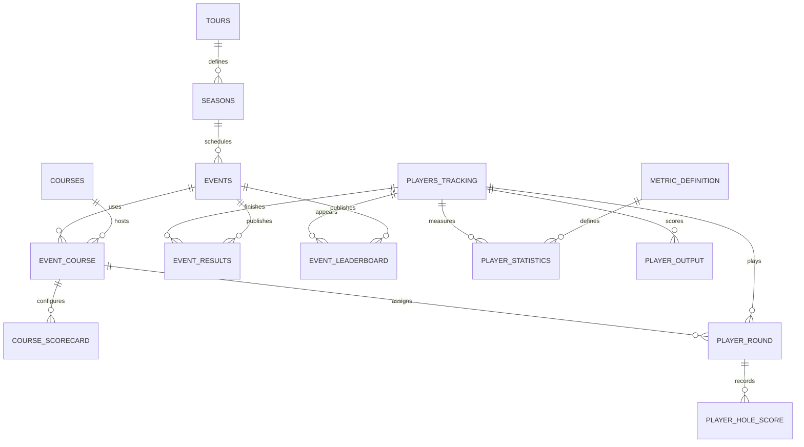
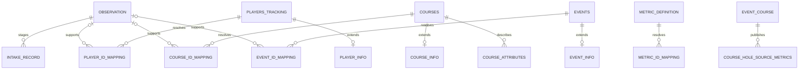

# GolfDB+ incoming data catalog

The production target is PostgreSQL 15+. GolfDB+ assigns UUIDs in the existing public registry. PGA TOUR is the lead provider for tournament data and Tourcast. Data Golf and historical files supplement coverage through explicit mappings. Importer availability and provider availability are tracked separately.

## Schema inventory

| Schema | Tables and views | Grain and write owner |
| --- | --- | --- |
| `public` | `tours`, `seasons`, `players_tracking`, `courses`, `events` | One row per canonical entity. Season ID is `YYYY-TOUR`. An event is an edition. The registry owns display names and event calendar fields. |
| `public` | `event_documents`, `content_items`, `content_entity_mentions` | Event attachment, content item, and reviewed entity mention. Content imports remain a separate pipeline. |
| `core` | `lookup_values`, `continents`, `time_zones`, `countries`, `states_provinces`, `measurement_units`, `course_themes`, `event_types`, `event_statuses`, `cut_rules`, `source_types`, `data_sources` | Shared vocabularies. Grouped lookups use group plus code. |
| `intake` | `observation`, `record` | One acquisition per provider, operation, request key and timestamp, then one staged record per acquisition and record key. |
| `intake` | `player_id_mapping`, `course_id_mapping`, `event_id_mapping`, `metric_id_mapping` | Provider IDs stored as text. Event IDs additionally use namespace and season. Provider stat IDs map to reviewed metric definitions. |
| `analytics` | `player_info`, `course_info`, `event_info` | One current extension row per canonical entity with optional source provenance. |
| `analytics` | `event_course`, `course_attributes`, `course_scorecard` | Event/venue bridge, dated course setup observation, and event/course/round/hole setup. Round 0 is the event default. |
| `analytics` | `event_leaderboard`, `event_results` | Event/player/publication. Live position and official results have separate writes and can retain ties and withdrawals. |
| `analytics` | `player_round`, `player_hole_score` | One current regulation player round and one score per completed hole on that round's course. |
| `analytics` | `metric_definition`, `player_statistics` | Versioned metric definition and player/season[/event[/round]]/metric/acquisition. |
| `analytics` | `player_output` | Model run/version/player/optional event/output code. Carries evidence cutoff, generation time, and optional sample count. |
| `analytics` | `course_hole_source_metrics` | Provider-reported event/course/hole/round aggregate and acquisition. Compare to derived metrics separately. |
| `analytics` | `schedule_tour_season` | One event edition including the primary venue, scheduled dates, status, purse and winner points. |
| `analytics` | `course_performance`, `course_difficulty_evaluation`, `course_hole_metrics` | Derived event/course scoring, event and season course difficulty, and full-event plus regulation round hole splits. |

The [migration](../Schema/003_incoming_data.sql) defines column types, keys, null rules, indexes and view calculations. The [reference guide](../Reference-DB-Design.md) covers the vocabulary. The older standalone Shot Tracker schema serves its own database. See the [migration guide](../Schema/README.md) for both entry points.

## Source routing

The [checked-in Parquet and TSV snapshots](../../Data/Source-Files/README.md) document source grain, event coverage, and integrity checks.

| Feed or file | Stage and promote | Join and validation |
| --- | --- | --- |
| PGA TOUR schedule REST, `Tournaments`, `TournamentOverview` | Tour/season, edition, venues, `event_info`, schedule view | Resolve official edition IDs and venue IDs. Keep tournament and leaderboard namespaces separate. Check source labels before treating awards as purse or winner points. |
| PGA TOUR player directory and profile REST | Player mapping and `player_info` | Keep source ID as text. Normalize sporting country codes only with a reviewed mapping. |
| `LeaderboardCompressedV3` | `event_leaderboard` publication | Preserve source rank display and status. Publish a validated complete observation in one transaction. |
| `TournamentPastResults`, completed official leaderboard | `event_results` publication | Validate edition, completion, finish statuses, currency and points. Use one publication ID per read to avoid mixing snapshots. |
| `TeeTimesCompressedV2`, `ScorecardCompressedV3`, `LeaderboardHoleByHole` | `player_round`, `player_hole_score` | Confirm course, round, completed hole, and timezone. Rounds may be staged with a pending venue. Hole rows require a resolved venue. |
| `CourseStats`, `CourseStatsOverview`, `CourseStatsDetails` | Course identifiers, verified setup, and source aggregates | A source ranking is not a computed rank. Only promote to `course_hole_source_metrics` when the event, course and hole resolve. Season-level source reports remain staged. |
| `StatOverview`, `StatDetails`, `ScorecardStatsV3Compressed` | Metric mapping and `player_statistics` | Keep leading zeroes in IDs. Review unit, denominator, time grain and effective date before promotion. |
| `ScorecardStatsComparisonCategories` | Staged category metadata | Category pills contain labels. Use the scorecard stats operation for numeric values. |
| `shotDetailsV4Compressed`, `TourcastVideos` | Immutable payload and staged decoded records | Preserve event/player/round, radar option, coordinate frame, and share URL. Canonical per-shot publishing is still separate from this incoming-data schema. |
| [2026 course setup Parquet](../../Data/Source-Files/course_setup_2026.parquet) | Staged event/course/round/hole setup candidates for `course_scorecard` | Resolve edition and course IDs, then validate par and yardage. Preserve pin coordinates in staging until the frame is verified. |
| [2026 shots Parquet](../../Data/Source-Files/shots_2026.parquet) | Staged shot records for offline analysis and later promotion | Preserve every source row. Resolve provider IDs and review repeated candidate keys before assigning shot identities. |
| [2026 tee times Parquet](../../Data/Source-Files/tee_times_2026.parquet) | Staged player/round assignment candidates for `player_round` | Resolve the event, player and course. Keep UTC time and source timezone. A scheduled start alone does not establish a played round. |
| [Historical results TSV](../../Data/Source-Files/pga_results_2001-2025.tsv) | Staged event/player candidates and final results | Edition key includes season, dates, title and location. Player name alone is insufficient. Verify status, currency and points before publishing. |
| [Data Golf 2021 round TSV](../../Data/Source-Files/raw_pga_536_2021.tsv) | Provider IDs, rounds and statistics | Scope the event ID by tour/season. Map `dg_id`, `course_num`, and round number independently. |
| ASA tournament-level CSV archive | Historical tournament-level evidence | Keep its grain separate from player rounds and hole observations. |
| Model run | `player_output` | Record immutable run UUID, version, input observation, cutoff and sample size. Validate upstream availability before calculating features. |

[Endpoint manifest](../../PGA-Tour-Data-API/endpoint_manifest.json) · [Packaged GraphQL documents](../../PGA-Tour-Data-API/src/pga_tour_api/queries) · [API evidence and field notes](SOURCE-RESEARCH.md)

## Query catalog

| File | Prepared statements |
| --- | --- |
| [Intake](../Queries/intake.sql) | Register observations, stage records, resolve or confirm all entity mappings, accept or quarantine. |
| [Promotion](../Queries/promote.sql) | Register canonical entities and seasons, define and map metrics, write each analytics input table. |
| [Reads](../Queries/read.sql) | Player profile, statistics and outputs, tour/season schedule, event metadata and publications, course profile and setup, scorecard, performance, difficulty and hole metrics. |

Load the query files on the same connection that executes them. Prepared statements live for that connection. Read queries return existing observations only. Course aggregates use completed player-hole scores. `round_number=0` means full event. Difficulty is dense-ranked by weighted mean strokes relative to par within an event or tour-season, with higher values harder. `sample_count` counts all scored holes and `par_sample_count` counts those with known setup par. Missing rounds do not fabricate zero rows. Field strength, weather adjustment, team scoring and playoffs are separate modeling work.

## Entity relationships

## Exploratory and operational queries

Load [explore.sql](../Queries/explore.sql) alongside the original read queries.

| Area | Prepared queries |
| --- | --- |
| Calendar and results | `event_window`, `result_publications`, `event_venues` |
| Player scoring and metrics | `event_round_scores`, `player_holes`, `player_par_splits`, `player_metric_history` |
| Provider comparisons | `course_hole_source_history` |
| Coverage and intake review | `event_coverage`, `intake_coverage`, `quarantined_records` |
| Reference and schema discovery | `lookup_values`, `schema_columns` |

[Migration 004](../Schema/004_query_views.sql) adds `analytics.player_par_scoring`, `analytics.event_data_coverage`, and `intake.observation_coverage`. Scoring uses the round-specific par when available and the event setup otherwise. Unknown par remains a separate group. Event coverage counts observed facts and publication IDs. It does not certify feed completeness. Player metric history retains provider revisions and requires an explicit metric version.
