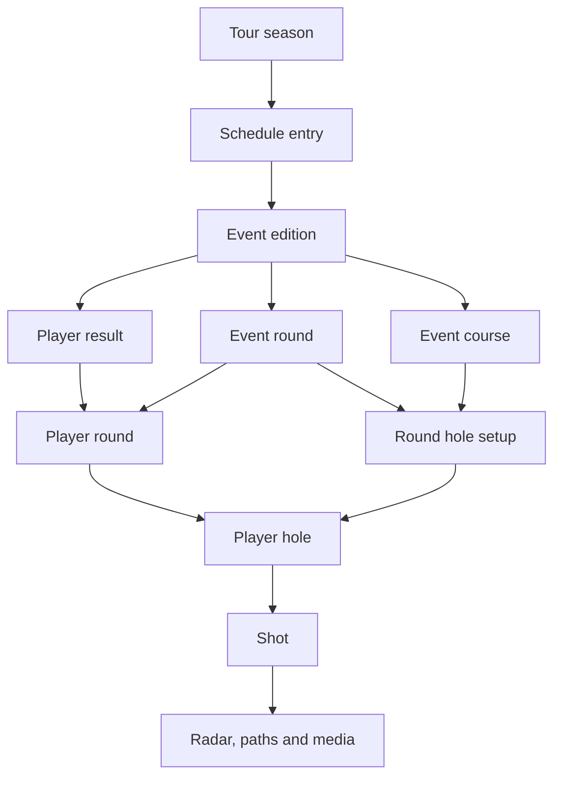

# Shot Tracker V1 database design

PostgreSQL 15+ stores the normalized golf data and serves the first three reporting views. Keep the source TSVs and original GraphQL responses as immutable files. GraphQL is a source interface. Each provider can retain its own IDs, names, and payload layout.

## Data model

| Area | Tables | Row grain |
| --- | --- | --- |
| Source intake | `ingest.source`, `batch`, `record` | Provider, immutable payload or file, staged row or decoded record |
| Players and identities | `player`, `player_external_id` | Canonical player, provider ID in its own namespace |
| Courses and holes | `course`, `course_external_id`, `course_hole` | Course or layout, provider ID, physical hole |
| Event and schedule | `tour`, `tour_season`, `event_series`, `event_edition`, `event_external_id`, `schedule_entry` | Tour, tour season, recurring tournament, specific edition, provider ID, calendar listing |
| Scoring and setup | `event_course`, `event_round`, `round_hole_setup`, `event_result`, `player_round`, `player_hole` | Edition venue, competition round, hole setup for a round, player finish, player round, player hole |
| Tourcast | `shot`, `shot_radar`, `coordinate_frame`, `shot_path`, `shot_path_point`, `shot_media` | Stroke, radar record, coordinate reference, trajectory version, ordered point, media item linked to shot |
| Stats and values | `metric_definition`, `metric_observation` | Versioned definition, dated metric at its supported reporting grain |
| Rankings and standings | `ranking_system`, `ranking_snapshot`, `ranking_entry`, `fedex_snapshot`, `fedex_entry` | Provider publication and player ranking, or dated standings publication and player standings |



A player round can be loaded with its course pending. A player hole needs a resolved course and round hole setup. The initial scoring grain is individual competition rounds with one course per player per round. Preserve team results and playoff-hole sequences in staging until their dedicated model is defined.

### Metric catalog conventions

| Category | Example metrics | Storage convention |
| --- | --- | --- |
| Off the tee and approach | SG OTT, SG APP, driving distance, driving accuracy, GIR | Strokes for SG, yards for driving distance once confirmed, and 0–1 for verified rates |
| Short game and putting | SG ARG, SG PUTT, scrambling, putts, fairway and rough proximity | Verify each provider's distance unit and denominator before conversion |
| Scoring and difficulty | Scoring average, scoring versus par, birdies, bogeys, hole difficulty rank | Course and hole metrics keep season, edition and round context where available |
| Derived values | Player ratings, course medians, field benchmarks | Each definition declares its unit, version and scale. Record observation date and sample size when known |

Definitions include descriptions, units and optional bounds. Observations can carry numeric and display values, with optional numerator and denominator. The same stat from two providers remains two observations until a reporting rule chooses which to use. Keep full precision in storage and round for display. For any custom rating, record its method and version before publishing its values.

## Source mapping

| Available input | Normalize into | Import rule |
| --- | --- | --- |
| `pga_results_2001-2025.tsv` | Seasons, event editions, schedule dates/location, player results and rounds | 148,883 rows across 25 season labels and 1,142 distinct combinations of season, dates, tournament and location. This edition key is provisional. Retain the original row and resolve identities before publishing. |
| `raw_pga_536_2021 (1).tsv` | Player/course/event mappings, rounds, tee times and round metrics | 284 player-round records for the 2021 Masters. Use `dg_id` for players and `course_num` for courses in Data Golf namespaces. Scope `event_id` to provider, tour and season when mapping the edition. |
| `Tournaments`, `TournamentOverview`, `TournamentPastResults` | Event and venue metadata, schedule enrichment, historical result reconciliation | `Tournaments` accepts IDs and supplies display metadata. Use a separate schedule or event-ID discovery source. Verify date, purse and points labels before promotion. Keep provider IDs for the tournament and any leaderboard or sub-event lookup in separate namespaces. |
| `LeaderboardCompressedV3`, `ScorecardCompressedV3`, `LeaderboardHoleByHole`, `TeeTimesCompressedV2`, `getPlayerTournamentStatus` | Event results/status, tee times, round totals and hole scores | Validate decoded shapes for compressed operations. Preserve the event timezone and local tee time until the round date is confirmed. Hole-by-hole data carries course and sequence context. |
| `shotDetailsV4Compressed`, `TourcastVideos` | Shots, optional radar, paths and media | Archive response and request parameters. Inspect decoded payloads before mapping coordinates and radar. The supplied shot query exposes an opaque payload and an `includeRadar` option. The video query exposes `shareUrl`. Store it separately from a confirmed playback URL. |
| `CourseStats`, `CourseStatsOverview` | Course/hole setup and scoring/difficulty observations | Keep course, edition and round context. Summary rows are aggregates. |
| `StatOverview`, `StatDetails`, `ScorecardStatsComparisonCategories` | Metric catalog, scoped values and category metadata | Map official stat IDs to metric codes and versions. Verify source units, null conventions and payload labels. The supplied comparison query selects category pills. |
| `TourCupSplit` | FedExCup snapshots and entries | Ingest official and projected arrays separately. Resolve the phase from request and response context. Fill starts and earnings only from verified fields or an independently verified matching standings feed. |
| OWGR, GolfDB+, Data Golf ranking feeds | Ranking snapshots and entries | Feed files were outside the supplied data. Import published snapshots with their dates and provider-specific player IDs. |
| `PriorityRankings`, `SignatureStandings`, news, generic content, odds, general videos | Raw staging or later work | Each feed has a distinct purpose. The three reporting views use the sources described above. |

### Historical import sequence

1. Register source hashes and stage the original columns, including blanks and status text. Preserve raw files and row keys for replay.
2. Resolve edition IDs using the provisional historical key and provider crosswalks. Use the season field as supplied. Calendar year differs from the season label for 10,075 rows in this file.
3. Resolve players against known provider IDs and reviewed aliases. The historical file supplies names without stable IDs. There are 50 groups repeated by season, dates, tournament, location and player name, and seven exact repeated rows beyond the first. Keep exact repeats traceable and quarantine conflicting or ambiguous rows before loading canonical results.
4. Preserve the original finish label. Parse numeric and tied ranks separately from CUT, WD, DNS, DQ and MDF. In some rows the position is numeric while the score field says MDF, so evaluate both fields. Parse `E` as even par. Import only supplied round columns and leave missing values null. Keep zero separate from missing for earnings and points. Verify historical currency before promoting earnings.
5. Enrich from PGA TOUR and Data Golf via verified crosswalks. Archive original compressed responses and validate the codec and decoded shape before enabling the adapters. Unknown coordinates, units, playback URLs and missing measurements stay null or remain staged. Tag provider-rendered and modeled paths separately from measured points.
6. Promote validated batches transactionally. Insert snapshots and entries together and set `is_complete` only after the publication passes coverage checks. Serialize corrections to a natural key, keep the original batch, and replace the corrected entries and provenance atomically. Partial feeds stay out of the reporting views.

## Reporting contracts

| SQL view | Grain | Selection rule |
| --- | --- | --- |
| `reporting.player_rankings_quarterly` | Player × calendar quarter | Use the last complete publication within each quarter for each provider. Return its rank and date where that player appears. A player absent from the selected publication gets a null for that provider. Rows exist where the player appears in at least one selected publication. |
| `reporting.fedex_cup_standings` | Tour × season × phase × player | Use the latest complete official snapshot for each phase. Expose publication time, official rank and points, plus verified events played and season winnings when available. |
| `reporting.pga_schedule` | PGA TOUR season × event edition | Keep every calendar listing, including future dates and missing awards. `event_winnings` means the event purse in the listed currency. `event_fedex_points` means the published winner's points for that calendar entry. Player earnings and points are separate result fields. |

Quarter starts are January 1, April 1, July 1 and October 1. Calendar quarters are independent of tour seasons. Use the provider dates to see how close to quarter end each ranking was published.

The historical file has player-event earnings and points, with point values first appearing in the 2007 rows. Official standings use published snapshots. Any later historical estimate from event results needs a separate view and clear labeling, especially for phase changes, incomplete inputs and official season totals. Keep a consistent phase vocabulary when importing standings.

## Run the migration

```sql
SELECT *
FROM reporting.player_rankings_quarterly
WHERE quarter_start = DATE '2025-01-01'
ORDER BY owgr_rank NULLS LAST, player;

SELECT rank, player, total_pts, events_played, season_winnings, winnings_currency
FROM reporting.fedex_cup_standings
WHERE tour_id = 'pga' AND season = 2025 AND standings_phase = 'regular_season'
ORDER BY rank, player;

SELECT season, tour_id, event_id, event_name, start_date, end_date,
       location, country, event_winnings, currency, event_fedex_points
FROM reporting.pga_schedule
WHERE season = 2025
ORDER BY start_date, event_name;
```

The migration creates tables and views in a fresh database. It seeds provider and tour codes. The results, snapshots and schedules need validated imports before the queries return golf data.

The migration and views passed fixture tests on a PostgreSQL 18.6 engine. Checks covered quarter boundaries, missing ranks, incomplete and projected snapshots, phase selection, PGA calendar filtering, shot and radar inserts, course consistency, and duplicate metrics.

## Implementation Notes

| Topic | Design choice |
| --- | --- |
| Assumptions | PostgreSQL 15+, calendar-quarter ranking snapshots, official standings by phase, and scheduled purse plus winner points for event awards. |
| Risks | Historical identities, edition-level matching, currencies, and Tourcast field availability require verification. A GraphQL query definition confirms selected fields, while a decoded response is needed to verify payload contents. |
| Next Steps | Load the historical archive to staging, reconcile the 2021 Masters against the round file, and use one decoded Tourcast round to validate the shot and coordinates mapping. Then backfill verified rankings and official standings feeds. |
| Alternatives | If a future report needs rankings averaged over a quarter or a historical points estimate, expose it in a separate view with its own methodology. |
| Performance Considerations | Use the supplied player, shot, date and metric indexes. Benchmark actual filters before partitioning shot points or materializing report views. |
| Maintenance Considerations | Keep provider mappings, immutable batches and parser versions. Review feed contract changes and publish corrected snapshots in one transaction. |

## References

- Project source files listed in the mapping above.
- [PostgreSQL 15 CREATE TABLE](https://www.postgresql.org/docs/15/sql-createtable.html) and [CREATE VIEW](https://www.postgresql.org/docs/15/sql-createview.html).
- [PGA TOUR FedExCup standings](https://www.pgatour.com/fedexcup/official-fedexcup-standings).
- [Official World Golf Ranking](https://www.owgr.com/) and [Data Golf Rankings](https://datagolf.com/datagolf-rankings).
